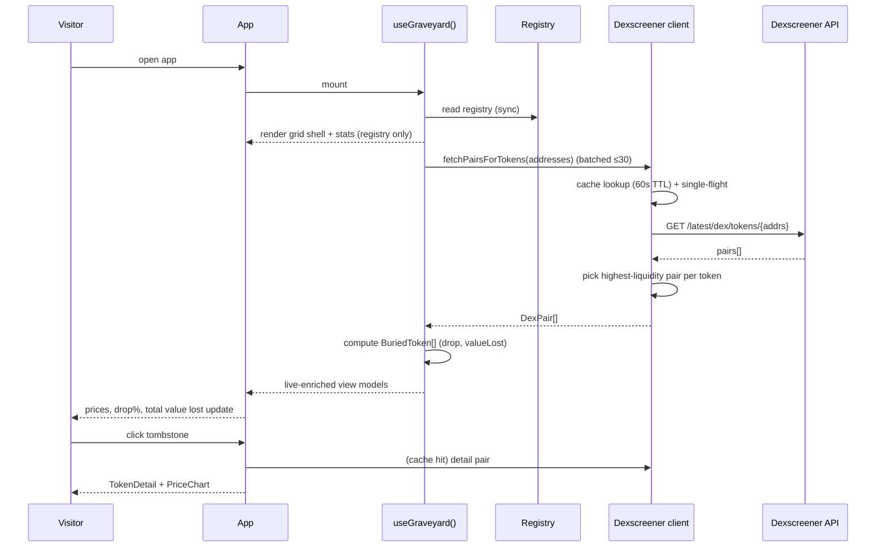

# Design Document

## Architecture Overview

Crypto Graveyard is a client-side single-page app. There is no backend and no API key. A curated in-app **graveyard registry** holds the narrative "death" metadata for each token (peak price, date of death, cause, contract address). A thin **Dexscreener client** fetches live pair data from the Dexscreener free public API; a `useGraveyard` hook joins the two to produce the view models the UI renders.

```
┌─────────────┐   ┌──────────────────┐   ┌──────────────────────┐   ┌────────────┐
│  Registry   │ + │ Dexscreener API  │ → │ useGraveyard() join  │ → │  React UI  │
│ (static TS) │   │ (live, cached)   │   │ → BuriedToken[]      │   │ (Tailwind) │
└─────────────┘   └──────────────────┘   └──────────────────────┘   └────────────┘
```

Data flow: Registry (static) + Dexscreener (live) → join in a hook → view models → React components (grid, cards, detail, chart, stats).

## Why a curated registry

The free Dexscreener API returns only current pair state (price, liquidity, volume, the 5m/1h/6h/24h price-change buckets, `pairCreatedAt`). It provides no historical OHLCV candles, no ATH/peak, and no "dead token" filter; search is capped at 30 results with no pagination. Peak price, date of death, and cause are therefore stored in a curated registry, while Dexscreener supplies the live values that change over time. This keeps the app free (no key) and honest about the API's limits.

## Tech Stack

- Vite + React 18 + TypeScript (strict mode)
- Tailwind CSS for styling, plus custom keyframe animations (fog drift, candle flicker) in the theme stylesheet
- Routing: lightweight client-side view state (grid ↔ detail), optionally surfaced as a URL hash so detail views are shareable
- Chart: a self-contained SVG sparkline component (no chart-library dependency), driven by reconstructed price points

## Project structure (new files)

```
src/
  main.tsx                    # Vite entry
  App.tsx                     # view router (grid | detail) + theme wrapper
  theme/
    index.css                 # Tailwind directives + keyframes (fog, flicker)
  components/
    StatsHeader.tsx
    SearchBar.tsx
    GraveyardGrid.tsx
    TombstoneCard.tsx
    TokenDetail.tsx
    PriceChart.tsx            # SVG sparkline + peak marker
    Fog.tsx                   # animated fog overlay (respects reduced-motion)
    Candle.tsx                # flickering candle motif
    states.tsx                # Loading, Error, Empty, NotFound states
  data/
    registry.ts              # curated dead-token registry + types
  lib/
    dexscreener.ts           # API client + in-memory cache + batching
    graveyard.ts             # derived computations (drop, value lost, price points)
  hooks/
    useGraveyard.ts          # load registry + live data → BuriedToken[]
    useTokenDetail.ts        # load a single token (registry or contract search)
  types.ts                   # shared domain types
```

## Data Models

### Registry entry (`data/registry.ts`)

```ts
export type CauseOfDeath = 'rugged' | 'abandoned' | '-99%';

export interface GraveToken {
  id: string;                 // stable slug, e.g. "luna-classic"
  name: string;
  symbol: string;
  chainId: string;            // Dexscreener chainId, e.g. "ethereum", "bsc"
  contractAddress: string;    // token contract address
  peakPriceUsd: number;       // curated all-time-high price (USD)
  dateOfDeath: string;        // ISO 8601 date
  cause: CauseOfDeath;
  lore?: string;              // optional epitaph text
}
```

### Dexscreener pair subset (`types.ts`)

```ts
export interface DexPair {
  chainId: string;
  dexId: string;
  url: string;
  pairAddress: string;
  baseToken: { address: string; name: string; symbol: string };
  priceUsd: string | null;
  priceChange: { m5: number; h1: number; h6: number; h24: number };
  liquidity: { usd: number };
  marketCap: number | null;
  fdv: number | null;
  pairCreatedAt: number | null; // ms epoch
  info?: { imageUrl?: string; websites?: { url: string }[]; socials?: { url: string; type: string }[] };
}
```

### Joined view model (`types.ts`)

```ts
export interface BuriedToken {
  token: GraveToken;           // curated metadata
  pair?: DexPair;              // live representative pair (highest liquidity)
  currentPriceUsd?: number;
  dropFromPeakPct?: number;    // signed: (current - peak) / peak * 100, e.g. -99.7
  peakMarketCapUsd?: number;   // supply * peakPrice
  currentMarketCapUsd?: number;
  valueLostUsd?: number;        // peakMarketCap - currentMarketCap
  status: 'live' | 'unreachable';
}
```

## Dexscreener API mapping

Base URL: `https://api.dexscreener.com`. Response shape: `{ schemaVersion, pairs: DexPair[] }`.

| Use | Endpoint | Notes |
|---|---|---|
| Live prices for registry tokens | `GET /latest/dex/tokens/{addr1,addr2,...}` | batch up to 30 comma-joined addresses |
| Contract-address resolution | `GET /latest/dex/search?q={addr}` | resolve an address not in the registry |
| Single pair (detail) | `GET /latest/dex/pairs/{chainId}/{pairAddress}` | optional; the token endpoint usually suffices |

The client:
- normalizes `pairs` into `DexPair[]`,
- groups pairs by `baseToken.address` and picks the **highest-liquidity** pair as the representative per token,
- tolerates `null` `priceUsd` and `marketCap`.

## Derived computations (`lib/graveyard.ts`)

```ts
// drop from peak, signed percentage (e.g. -99.7)
dropFromPeak(peakPriceUsd, currentPriceUsd) =>
  ((currentPriceUsd - peakPriceUsd) / peakPriceUsd) * 100

// circulating supply inferred from current market cap & current price
estimateSupply(currentMarketCapUsd, currentPriceUsd) =>
  currentMarketCapUsd / currentPriceUsd

// peak market cap = supply * peak price; value lost = peak - current
valueLostUsd(peakPriceUsd, currentPriceUsd, currentMarketCapUsd) =>
  estimateSupply(currentMarketCapUsd, currentPriceUsd) * peakPriceUsd - currentMarketCapUsd

// reconstruct ~5 price points from the priceChange buckets + current priceUsd
reconstructPricePoints(priceUsd, priceChange) => [
  { t: now - 24h, price: priceUsd / (1 + priceChange.h24 / 100) },
  { t: now - 6h,  price: priceUsd / (1 + priceChange.h6 / 100) },
  { t: now - 1h,  price: priceUsd / (1 + priceChange.h1 / 100) },
  { t: now - 5m,  price: priceUsd / (1 + priceChange.m5 / 100) },
  { t: now,       price: priceUsd },
]
```

## Data flow



## Error handling strategy

- **Network/HTTP error or non-2xx:** the Dexscreener client returns a typed `DexError`; `useGraveyard` marks affected tokens `status: 'unreachable'` and renders registry-only data with a "price unknown" badge.
- **Empty `pairs[]` for an address:** treated as "no live data"; same `unreachable` path.
- **Malformed/missing fields:** every numeric parse is guarded (`Number(x)` with `isNaN`/finiteness checks); a single bad pair never throws.
- **Invalid contract search query:** shows a "no grave found" state, never an uncaught exception.
- **Rate limiting:** the 60s cache plus single-flight dedupe keeps requests well under Dexscreener's free limits (~300/min general; the token-price endpoint ~60/min). Registry addresses are batched (≤30 per call).

## Performance & caching

- Progressive render: the stats header and grid shell render from the registry before any network call resolves.
- In-memory cache keyed by request URL with a 60s TTL; single-flight so concurrent callers share one promise.
- Registry addresses are batched into as few calls as possible (≤30 each).
- The SVG sparkline is cheap; the detail view lazily computes points on open.
- Derived view models are memoized in `useGraveyard` (`useMemo`).

## Accessibility & theme

- Cards are real `<button>`/`<a>` elements (focusable, operable with Enter/Space).
- The grid uses semantic landmarks; the chart has an accessible name summarizing its data; the stats use `aria-live="polite"` for value-lost updates.
- Color contrast is checked against the dark palette (WCAG AA).
- `prefers-reduced-motion` disables the fog and flicker keyframes.

## Testing strategy

- **Unit:** the pure functions in `lib/graveyard.ts` (drop, supply, valueLost, `reconstructPricePoints`, representative-pair selection). The Dexscreener client with mocked `fetch` (batching, cache TTL, single-flight, highest-liquidity selection, typed errors).
- **Component:** `TombstoneCard` renders all fields and the cause styling; `PriceChart` renders the expected points and peak marker; the loading/error/empty/not-found states render correctly.
- **Integration:** `useGraveyard` joins the registry and mocked Dexscreener pairs into `BuriedToken[]`; search filters by name/symbol/contract; a contract-address search with no registry match falls through to Dexscreener.

## Security considerations

- No secrets, keys, or backend. All data is public market data.
- Dexscreener responses are treated as untrusted: numeric fields are validated/coerced, never `eval`'d; text fields render as text (React escapes by default).
- Contract-address search input is used only as a URL path/query parameter for `fetch`, never interpolated into shell, SQL, or HTML.

## Open questions / future enhancements

- A richer historical candlestick chart requires a data source beyond the free Dexscreener API (out of scope here).
- Embedding Dexscreener's own chart widget as an alternative to the reconstructed sparkline.
- Automated registry updates or community submissions.
